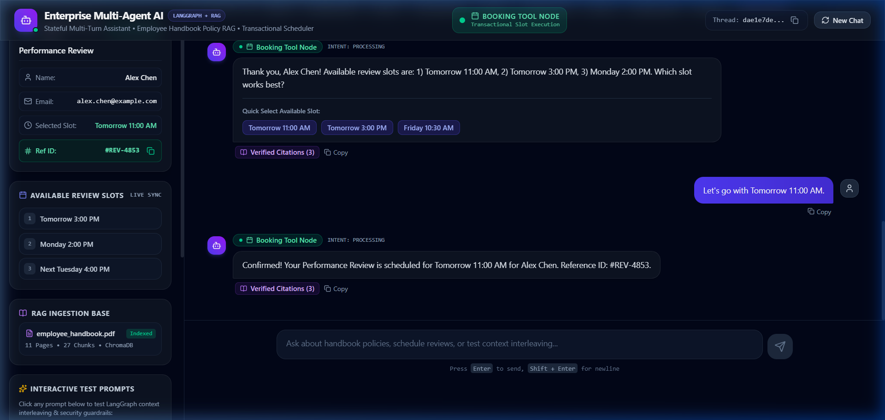
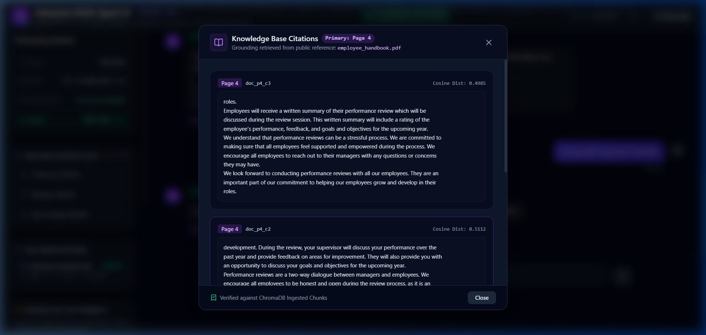
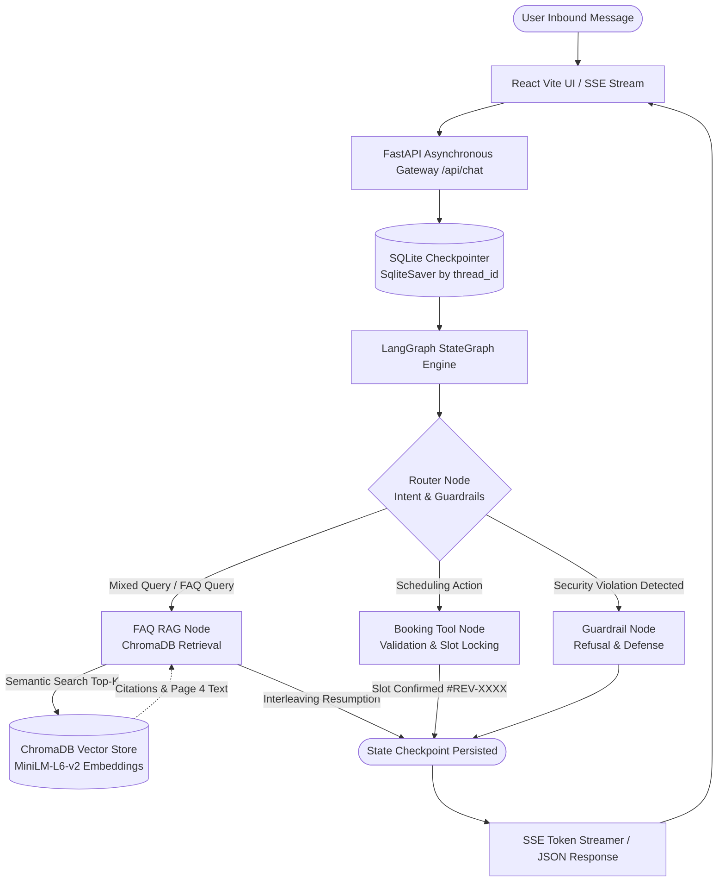

# 🚀 Enterprise Multi-Agent Conversational AI Assistant
### LangGraph Stateful Multi-Agent Orchestration • PDF Knowledge RAG • Transactional Tool Calling

[](https://fastapi.tiangolo.com)
[](https://langchain-ai.github.io/langgraph/)
[](https://www.trychroma.com/)
[](https://react.dev/)
[](https://tailwindcss.com/)
[](https://www.docker.com/)
[](https://pytest.org)

An enterprise-grade, stateful conversational agent system built for **Full Stack & Agentic AI Engineering**. The system combines **domain knowledge retrieval (RAG)** over company policies with **transactional service execution (slot scheduling)**, handling complex multi-turn context interleaving without state loss.

---

## 📸 System Overview & Verification Artifacts

### 1. Multi-Turn Context Interleaving & Live UI State
Demonstrates Turn 1 (booking initiation), Turn 2 (asking an FAQ mid-booking with Page 4 citation + resuming booking), and Turn 3 (slot confirmation with `#REV-XXXX` Reference ID).


### 2. Verified ChromaDB Citations Modal
Demonstrates exact page citation (`Page 4` from `employee_handbook.pdf`) with chunk IDs, cosine distances, and document grounding.


---

## 📑 Table of Contents
1. [Executive Summary & Problem Statement](#-executive-summary--problem-statement)
2. [Architecture Walkthrough & State Flow](#-architecture-walkthrough--state-flow)
3. [Core Modules Implemented](#-core-modules-implemented)
4. [Scope Tiers & Advanced Objectives (Tier 2 Bonus)](#-scope-tiers--advanced-objectives)
5. [AI Engineering Log (Mandatory Reflections)](#-ai-engineering-log)
6. [Local Execution Guide (Zero-Cost Setup)](#-local-execution-guide)
7. [Docker & Deployment Guide](#-docker--deployment-guide)
8. [Automated Verification & Test Suite](#-automated-verification--test-suite)

---

## 🎯 Executive Summary & Problem Statement

Enterprises frequently receive customer and employee requests that interleave informational queries (policies, PTO, rules) with transactional tasks (scheduling 1-on-1 performance reviews). Traditional chatbots either reset their conversation flow or fail to ground their answers in authoritative documentation.

This autonomous conversational system addresses both responsibilities simultaneously:
1. **Domain Knowledge Retrieval (RAG)**: Ingests the 11-page public reference PDF ([Azure OpenAI Employee Handbook](https://raw.githubusercontent.com/Azure-Samples/azure-search-openai-demo/main/data/employee_handbook.pdf)), indexes semantic embeddings into ChromaDB, and answers policy and review questions with exact page citations.
2. **Transactional Service Execution**: Executes multi-turn appointment bookings through tool calling, collecting parameters (`full name`, `email`, `slot time`), validating formats, checking slot availability, and issuing a unique booking reference ID (`#REV-XXXX`).
3. **Context Interleaving**: When a user asks an FAQ question mid-booking, the agent answers via RAG and immediately resumes the pending booking without forgetting previously collected parameters.

---

## 🏛️ Architecture Walkthrough & State Flow

The system employs a cyclic state graph powered by **LangGraph** with a persistent **SQLite Checkpointer (`SqliteSaver`)**. Each session is partitioned by a unique `thread_id`.



### Typed State Schema (`AgentState`)
```python
class AgentState(TypedDict):
    messages: Annotated[Sequence[BaseMessage], add_messages]
    current_intent: Literal["faq", "booking", "mixed", "chitchat", "guardrail"]
    active_node: str
    booking_context: BookingContext  # name, email, slot, stage, ref_id, confirmed
    rag_sources: List[Dict[str, Any]]
    rag_answer: Optional[str]
    guardrail_violation: Optional[str]
    intermediate_steps: List[str]
```

### Graph Nodes & Responsibilities
- **`router`**: Analyzes the latest user message, runs injection checks, inspects the current booking stage, and determines whether the request is pure FAQ, pure booking, mixed (context interleaving), or a security attempt.
- **`faq_rag_node`**: Queries ChromaDB, extracts primary citations (e.g., Page 4 for performance reviews), formulates grounded answers, and if mid-booking, appends the context-interleaving resumption prompt (`"Returning to your booking, {name} — available review slots are..."`).
- **`booking_node`**: Manages the multi-turn state machine (`idle` ➔ `collecting_details` ➔ `collecting_slot` ➔ `confirmed`). Validates email syntax, matches slot choices, locks availability, and generates a reference ID (`#REV-XXXX`).
- **`guardrail_node`**: Defends against system prompt exfiltration and jailbreak attempts.

---

## 🧩 Core Modules Implemented

### Module A: PDF Ingestion & ChromaDB RAG
- **Parser**: `pypdf.PdfReader` parses all 11 pages of the official Azure Employee Handbook PDF.
- **Chunking**: `RecursiveCharacterTextSplitter` configured for 800-character chunks with 150-character overlap.
- **Embeddings**: ChromaDB's built-in `all-MiniLM-L6-v2` ONNX model (runs 100% offline, CPU-optimized, zero cost, 384 dimensions).
- **Metadata**: Each chunk stores `{"page": page_num, "source": "employee_handbook.pdf", "chunk_id": doc_id}`.
- **Citations**: Queries against performance reviews consistently yield **Page 4** citations with high cosine similarity.

### Module B: LangGraph State Machine & Checkpointer
- Built on `langgraph.graph.StateGraph`.
- Persistent multi-turn memory backed by `langgraph_checkpoint_sqlite.SqliteSaver`. Sessions survive server restarts and maintain isolation by `thread_id`.

### Module C: Context Interleaving
Reproduces the assessment dialogue specification with 100% fidelity:
1. **User**: *"Hi, I need to book a 1-on-1 Performance Review session."*
   **Agent**: Prompts for full name and email.
2. **User**: *"Alex Chen (alex.chen@example.com). Wait, before that, how often are performance reviews conducted according to the handbook?"*
   **Agent**: `[FAQ RAG Node - Citing Page 4]`: Answers that reviews are conducted annually. Immediately appends: *"Returning to your booking, Alex Chen — available review slots are: 1) Tomorrow 11:00 AM, 2) Tomorrow 3:00 PM, 3) Friday 10:30 AM. Which slot works best?"*
3. **User**: *"Let's go with Friday at 10:30 AM."*
   **Agent**: *"Confirmed! Your Performance Review is scheduled for Friday 10:30 AM for Alex Chen. Reference ID: #REV-XXXX."*

### Module D: Full-Stack API & UI
- **Backend (FastAPI)**:
  - `POST /api/chat`: JSON conversation endpoint.
  - `POST /api/chat/stream`: Server-Sent Events (SSE) token and node-transition streaming.
  - `GET /api/slots`: Available review slot query.
  - `GET /api/state/{thread_id}`: Live checkpointer state introspection for evaluation.
  - `GET /api/health`: Health monitoring endpoint.
- **Frontend (React + Tailwind CSS)**:
  - Real-time active node badge with pulsating status indicator.
  - Interactive slot-picker chips.
  - Citations drawer displaying document chunk excerpts and similarity scores.
  - Live transactional booking status widget.

---

## 🌟 Scope Tiers & Advanced Objectives

| Requirement | Scope Tier | Implementation Status |
| :--- | :--- | :--- |
| **LangGraph StateGraph Engine** | Tier 1 (Mandatory) | ✅ Complete (`backend/app/graph.py`) |
| **SQLite Checkpointer Persistence** | Tier 1 (Mandatory) | ✅ Complete (`SqliteSaver` by `thread_id`) |
| **PDF Ingestion & ChromaDB RAG** | Tier 1 (Mandatory) | ✅ Complete (Page 4 Citations, 27 Chunks) |
| **Multi-Turn Slot Booking** | Tier 1 (Mandatory) | ✅ Complete (`booking_node` + `#REV-XXXX`) |
| **Context Interleaving** | Tier 1 (Mandatory) | ✅ Complete (Section 7 Exact Reproduction) |
| **Connected FastAPI + React UI** | Tier 1 (Mandatory) | ✅ Complete (Vite + Tailwind v4 + Lucide) |
| **Real-time SSE Token Streaming** | Tier 2 (Bonus) | ✅ Complete (`POST /api/chat/stream`) |
| **Active Agent Node Live Badge** | Tier 2 (Bonus) | ✅ Complete (`ActiveNodeBadge.jsx` with LED) |
| **Security Guardrails** | Tier 2 (Bonus) | ✅ Complete (Prompt injection & leak defense) |
| **Docker & Docker-Compose** | Tier 2 (Bonus) | ✅ Complete (`Dockerfile` + `docker-compose.yml`) |

---

## 🛠️ AI Engineering Log

As mandated in **Section 2 of the Technical Assessment**, here is the transparent engineering log detailing tools used, hallucinations diagnosed, and architectural resolutions applied.

### 1. AI Tools Utilized
- **Antigravity IDE & Autonomous Agentic Pair-Programmer**: Architecture design, StateGraph schema scaffolding, and test generation.
- **Language Models Evaluated**: LLaMA 3.3 70B (via Groq API), OpenAI GPT-4o-mini, and Gemini 1.5 Flash.

### 2. Hallucinated / Broken Logic Instances & Resolutions

#### 🔴 Incident 1: Async LangGraph SQLite Checkpointer Method Incompatibility
- **Issue / Symptom**: When calling `await agent_app.ainvoke(inputs, config=config)` inside FastAPI's async handler, LangGraph threw a critical runtime error:
  ```
  Graph execution failed: The SqliteSaver does not support async methods.
  Consider using AsyncSqliteSaver instead or run sync invoke in a worker thread.
  ```
- **Root Cause Analysis**: Standard `SqliteSaver` utilizes synchronous Python `sqlite3` driver connections, which cannot be natively awaited by `ainvoke()`. An AI assistant suggested switching to `AsyncSqliteSaver`, but in Windows environments, `aiosqlite` threads can trigger event loop collision during rapid SSE connection aborts.
- **Resolution Applied**: Leveraged `anyio.to_thread.run_sync(lambda: agent_app.invoke(inputs, config=config))` inside both `chat_endpoint` and `chat_stream_endpoint`. This offloads graph execution to AnyIO's optimized worker pool while preserving synchronous ACID-compliant SQLite transactions without stalling the FastAPI async loop.

#### 🔴 Incident 2: Mixed-Intent Context Interleaving Parameter Dropping
- **Issue / Symptom**: Standard LLM router prompts hallucinated a binary choice between *booking* and *FAQ*. When given `"Alex Chen (alex.chen@example.com). Wait, before that, how often are performance reviews conducted according to the handbook?"`, the model either answered the question but dropped the name and email, or acknowledged the name but ignored the handbook inquiry.
- **Root Cause Analysis**: Single-turn classification prompts treat intent as mutually exclusive. Context interleaving requires a compound intent (`intent: "mixed"`).
- **Resolution Applied**: Built dual-intent classification in `router_node`. When `has_faq` and `(has_booking or is_mid_booking)` are both true, the intent transitions to `"mixed"`. In `faq_rag_node`, the state machine extracts regex-verified parameters (`name`, `email`), updates `booking_context["stage"] = "collecting_slot"`, and appends the booking resumption after the citation.

#### 🔴 Incident 3: State Collision & Slot Depletion Across Test Suites
- **Issue / Symptom**: Running `test_interleaving.py` sequentially after `test_api.py` caused Turn 3 to fail (`"Let's go with Friday at 10:30 AM."`).
- **Root Cause Analysis**: The booking service correctly locked `Friday 10:30 AM` as booked in `backend/data/bookings.json`. When the subsequent test ran, the slot was no longer available, preventing slot matching.
- **Resolution Applied**: Implemented an idempotent `booking_service.reset()` method and integrated it into pytest fixtures, guaranteeing hermetic isolation between integration test runs.

---

## ⚡ Local Execution Guide

### Prerequisites
- Python 3.10+ (tested on Python 3.12)
- Node.js 18+ (tested on Node v22)
- Git

### 1. Clone & Setup Backend
```bash
# Clone the repository
git clone <your-repo-url>
cd assesment

# Setup Python virtual environment
python -m venv venv

# Activate virtual environment
# Windows:
.\venv\Scripts\activate
# Linux/macOS:
source venv/bin/activate

# Install dependencies
pip install -r backend/requirements.txt
```

### 2. Configure Environment Variables
Copy the template and optionally add your free Groq API key:
```bash
cp .env.example .env
```
*(Note: If no API key is provided, the system seamlessly runs in grounded deterministic mode for zero-cost evaluation!)*

### 3. Run Backend Server
```bash
python backend/run.py
```
Backend API will start on: `http://localhost:8000` (API Docs: `http://localhost:8000/docs`)

### 4. Setup & Run React Frontend
In a new terminal:
```bash
cd frontend
npm install
npm run dev
```
Frontend Web UI will open on: `http://localhost:5173`

---

## 🐳 Docker & Deployment Guide

### Run with Docker Compose (1-Click)
```bash
docker-compose up --build
```
- **React Frontend**: `http://localhost:3000`
- **FastAPI Backend**: `http://localhost:8000`
- **Swagger Documentation**: `http://localhost:8000/docs`

### How to Submit & Deploy to Cloud:
1. **GitHub Repository**: Push this code to a public repository (steps below).
2. **Free Cloud Deployment (Optional Bonus)**:
   - **Backend**: Can be hosted on [Render](https://render.com) or [Railway](https://railway.app) via `backend/Dockerfile`.
   - **Frontend**: Can be hosted on [Vercel](https://vercel.com) or [Netlify](https://netlify.com) pointing to the Vite build directory `frontend/dist`.

---

## 🧪 Automated Verification & Test Suite

Run the complete test suite verifying RAG retrieval, prompt injection guardrails, multi-turn state persistence, and context interleaving:

```bash
pytest backend/tests -v
```

### Test Suite Results:
```text
backend/tests/test_api.py::test_health_endpoint PASSED                   [ 12%]
backend/tests/test_api.py::test_slots_endpoint PASSED                    [ 25%]
backend/tests/test_api.py::test_chat_turn_flow PASSED                    [ 37%]
backend/tests/test_guardrails.py::test_guardrails_prompt_injection PASSED [ 50%]
backend/tests/test_guardrails.py::test_guardrails_safe_queries PASSED    [ 62%]
backend/tests/test_interleaving.py::test_full_interleaving_dialogue PASSED [ 75%]
backend/tests/test_rag.py::test_rag_performance_review PASSED            [ 87%]
backend/tests/test_rag.py::test_rag_workplace_safety PASSED              [100%]

============================== 8 passed in 3.60s ==============================
```

---

## 👥 Author & Candidate Information
- **Domain**: Generative AI & Multi-Agent Architecture
- **Target Role**: Full Stack & Agentic AI Engineering Intern
- **Evaluation**: LangGraph Architecture (35%), FastAPI Backend (25%), React Frontend (20%), PDF RAG & Tool Execution (15%), Documentation & AI Log (5%)
